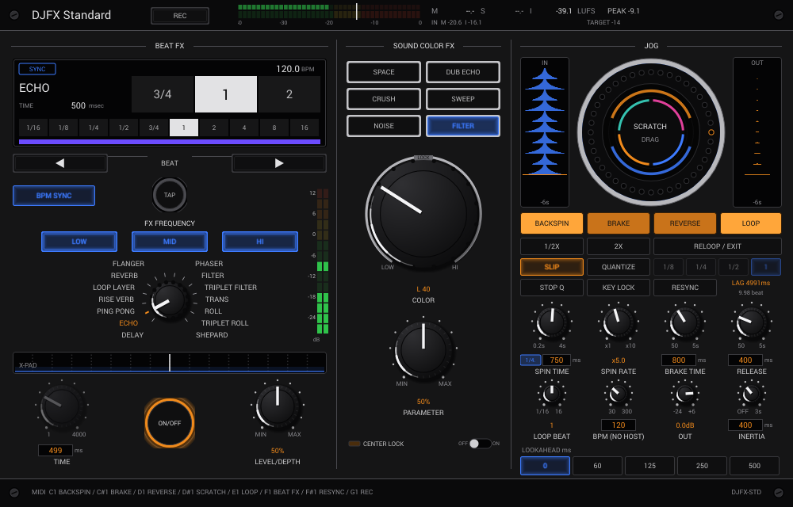

# DJFX Standard

現場でのDJ操作(ミキサーのエフェクト、プレーヤーのバックスピン・ブレーキ・スクラッチ)を、実機がなくてもDAW上でデモンストレーションできたらいいなと思って作りました。
DJミキサーとDJプレーヤーの操作を、VST3で再現します。Windows / Mac。出力ファイルは `DJFX Standard.vst3`(CMakeのターゲット名は内部名のまま `NamiDJFX`)。UIは実機の面板をイメージした見た目で、フォントは Roboto(英数字)/ Noto Sans JP(日本語)を埋め込んでいます。拍の同期はDAWのテンポに合わせます。



操作中のパーツにカーソルを合わせると、下の帯に短い説明が出ます。


**ベータ版です。** DAWによって動きが違う可能性があります。不具合は Issues へお願いします。

**個人の非公式の作品で、特定のメーカー・製品とは関係ありません。** 音とパラメータの範囲は、一般的なDJ機材の操作を参考に、耳と数値で寄せた近似です。

## ダウンロード

**[最新版をダウンロード(Releases)](https://github.com/namigroove/djfx-standard/releases/latest)**

1. Releases の `Assets` から、お使いのOS用のZIPをダウンロードして展開します。
2. `DJFX Standard.vst3` を次の場所に置きます。
   - Windows: `C:\Program Files\Common Files\VST3`
   - Mac: `/Library/Audio/Plug-Ins/VST3`
3. DAWでプラグインを再スキャンします。

## 入っているもの

### BEAT FX(14種)
DELAY / ECHO / PING PONG / RISE VERB / LOOP LAYER / REVERB / FLANGER / PHASER / FILTER / TRIPLET FILTER / TRANS / ROLL / TRIPLET ROLL / SHEPARD

- BPM同期(1/16〜64拍)と、ミリ秒指定の切り替え
- FX FREQUENCY: LOW(〜250Hz) / MID / HI(2.5kHz〜)を組み合わせて選べます(実機と同じ)。選んだ帯域だけにFXがかかります
- 液晶の拍表示、BEAT ◀▶、TAP(タップテンポ)で時間を選びます。TIMEノブを回すと自由な時間(ms)になります
- エフェクトは周りに名前が並んだロータリーで選びます(名前のクリック、つまみのドラッグ、ホイール)
- X-PAD: 触っている間だけON。左右に動かすと時間(拍)が変わります
- LEVEL/DEPTH: 効果の量

### SOUND COLOR FX(6種)
SPACE / DUB ECHO / SWEEP / NOISE / CRUSH / FILTER
COLORノブ(中央でバイパス、CENTER LOCKで中央付近をロック)とPARAMETERノブの2つで操作します。

### JOG(プレーヤーの操作)
バックスピン / ブレーキ(VINYL STOP) / リバース / ビートループ / スクラッチ

- 常に直近10秒を録音しておき、押している間だけ再生位置を操作します。離すと、裏で進んでいた現在位置にクロスフェードで戻ります(プレーヤーのSLIPモードと同じ動き)。
- スクラッチは画面のジョグをドラッグします(ドラッグの回転速度が再生速度になります)。オートメーションで `Scratch Touch` と `Scratch Speed` を書くこともできます。
- 前方向へのスクラッチは「まだ来ていない音」を読めないので、既定では現在位置より先へ進めません。
  `LOOKAHEAD` を上げると、その分だけ全体が遅れて(PDCで補正されます)、先へ進める余白ができます。

### MIDI
| ノート | 動作 |
|---|---|
| C1 (36) | バックスピン(押している間) |
| C#1 | ブレーキ |
| D1 | リバース |
| D#1 | スクラッチ(タッチ) |
| E1 | ビートループ |
| F1 | BEAT FX ON |

## ビルド

```
git clone --depth 1 --branch 8.0.8 https://github.com/juce-framework/JUCE.git external/JUCE
cmake -S . -B build
cmake --build build --config Release --target NamiDJFX_VST3
```

GitHubにpushすると、Actionsが Windows と Mac のVST3をビルドして `Artifacts` に出します。

### テスト
- `test/offline_test.cpp`: DSPの単体テスト(JUCE不要)。全エフェクトの数値確認(エコーの遅延時間、ロールの周期、バックスピンの減速、モビウスの上昇/下降 など)
  `g++ -std=c++17 -O2 -o dsp_test test/offline_test.cpp && ./dsp_test`
- `test/proc_test.cpp`: プラグイン本体の結合テスト(MIDI・パラメータ・モノ・状態保存)

## 近似にしている点

- BEATの値の並びは取扱説明書の範囲から決めています。TRIPLET系(1/12〜12/3)は並びを推定しています。
- RISE VERB は「ピッチが上がっていくフィードバック残響」、SHEPARD は「入力の大きさに追従する、上がり続ける/下がり続ける音」としています。
- LOOP LAYER は録音して重ねるループです。LEVEL/DEPTHを右へ回し切ると固定します。
- LEVEL/DEPTHの混ぜ方(DELAY系は足し算、FILTER・FLANGER・PHASER・ROLLなどは原音との入れ替え)は聴感で決めています。

## SOUND COLOR FX
| FX | COLOR 左 / 右 | PARAMETER |
|---|---|---|
| SPACE | 中+低域 / 中+高域にリバーブ | フィードバック |
| DUB ECHO | 中域 / 高域に反響 | フィードバック |
| SWEEP | ノッチ(帯域が広がる) / バンドパス(帯域が狭まる) | 中心周波数 |
| NOISE | ノイズ用フィルターのカットオフ 下げる / 上げる | ノイズ音量 |
| CRUSH | クラッシュのみ / クラッシュ後にHPF | クラッシュ量 |
| FILTER | LPF / HPF | レゾナンス |

CENTER LOCK: ON のときCOLORを速く回しても中央で止まり、手を離すと解除(止まった側へ戻せば続けて回せる)。
未確認/仮定: DUB ECHOの遅延時間(説明書に記載なし → 1拍で仮置き)、NOISEのEQ/ISOによる音質調整(チャンネルEQなしのため未対応)。

## 再生速度系の長さを拍で決める
- SPIN TIME / BRAKE TIME のつまみを右クリック → 1/16, 1/8, 1/8., 1/4, 1/4., 1/2, 1/2., 1bar, 2bar, 4bar(1/4=四分音符=1拍)。そのときのBPMでmsに換算してつまみを動かし、以後はBPMが変わっても拍の長さに追従。つまみを回すか数字を打つとFREE(ms)に戻る。
- BEAT FX の TIME も右クリックでそのFXの拍リストから選べる(BEATボタンと同じく拍同期になる)。
- 値の欄はダブルクリックで数字だけ入力。単位(ms)は欄の外に固定表示。

## ジョグ操作の追加
- **RELEASE**: BRAKE(止める)の逆。放すと設定時間で等速まで立ち上がる。範囲はBRAKEと同じ(50ms〜5s)で、右クリックで音符(BPM連動)も選べる。
- **SLIP**: ON=離すと裏で進んでいたライブ位置へ戻る(従来どおり。BRAKEだけは放したあとRELEASEで加速してから戻る)。OFF=離した位置から続け、ライブより遅れた状態になる。画面右下のLAGに遅れをms・拍で表示。RESYNC(MIDI F#1)かSLIP ONでライブへ戻る。
- **QUANTIZE**(1/8,1/4,1/2,1): ONのとき BACKSPIN/BRAKE/REVERSE/LOOP の開始を、DAWの次の拍の頭までサンプル精度で待たせる(DAWが再生中でPPQが取れるときのみ。拍の頭より前に離すと何も起きない)。SLIP OFFのときは、続ける位置の遅れも拍の整数倍に揃える(ほぼライブなら自動でライブへ戻る)。
- **ループ**: 1/2X・2X(LOOP BEATを2倍/半分。ループ中でも効く)、RELOOP/EXIT(押すとループに入り、もう一度押すと抜ける。抜けたあと押すと直前のループの始点から入り直す)。LOOPのホールドは従来どおり。
- **DAW連動**: DAWの停止・再生開始・シーク(PPQの飛び)を検出し、遅れた再生を捨てて、シーク前の録音は巻き戻しやスクラッチに使わない。プラグインからDAWの再生位置を動かすことはできない(VST3にその仕組みがない)。
- 長いバッファ(2048サンプル超)でも、BEAT FXの同期位相が途切れないよう修正。

## 記録(REC): 操作をDAWのオートメーションに記録する
- 画面上部の REC を押す(もう一度押すまで)、または MIDI の G1 を押している間、操作系パラメータ(FX・X-PAD・COLOR・ジョグ操作など。BPM・出力・先読みは除く)を「触っている」状態にし続ける。
- DAW側のオートメーションを Touch / Latch / Write にしておくと、その間の動きが記録される(動かしていない間の値も1点として書く)。Read / Off のときは記録されない。
- RECを入れたまま画面のつまみを離しても、つかみ直して記録を続ける。
- 手動でマウスを使うと「押しながら別のつまみを回す」ことができないので、画面のRECはON/OFFの切り替え式。押している間だけにしたいときはMIDIのG1を使う。

## 波形表示と配色
- ジョグの左右に縦型の波形を表示。左が IN(入力)、右が OUT(エフェクト後)。上が「いま」、下へ約6秒ぶん過去。
- IN には再生ヘッド(ライブからの遅れ)が黄色い線で出る。ループ中は範囲が薄く塗られる。
- 波形は過去の音だけ。未来は出ない(プラグインはDAWの先の音を持てないため)。
- 配色はグラデーション・質感・ハイライト線を使わない単色。

## 慣性・KEY LOCK・STOP Q
- INERTIA ノブ(0〜3000ms、数字入力可、0でOFF): スクラッチを離したとき、離した速度から等速へこの時間かけて滑らかに戻る。長いほど盤が勢いで回り続ける。SLIP ON のときは等速に戻ってからライブ位置へ戻る。
- KEY LOCK(ボタン): ONにすると、スクラッチ/BACKSPIN/BRAKE/REVERSE中も音程が変わらない(50msのグレイン方式)。OFFはテープ式(速度=音程)。止まっている間は無音。
- STOP Q(ボタン): BACKSPIN/BRAKEを押した瞬間に、止まる位置が次の拍の目盛り(QUANTIZEの1/8・1/4・1/2・1)に乗るよう、止まるまでの時間を延ばす。DAWが再生中で拍の位置がわかるときだけ働く。

## 見た目
- 面板は黒いつや消し、印字は灰色〜白、点灯するものだけ色が付く(青=ボタンの光、橙=CUE、紫=液晶のX-PAD帯)。
- JOGの4つのホールドボタン(BACKSPIN/BRAKE/REVERSE/LOOP)は実機のCUEボタンと同じ橙。押している間は明るく点く。
- ジョグは銀の外周リング・くぼみが並ぶ黒いリング・黒い盤・中央の色付きリング(プレーヤー風)。
- フォント: 英数字は Roboto、日本語は Noto Sans JP(メニューなど)。日本語の文字を増やしたときは、`assets/fonts/NotoSansJP-Medium-subset.ttf` を作り直す(使う文字だけに絞ってあるため)。

## ラウドネス表示(LUFS)
- 画面上部に出力のラウドネスを表示: M=モメンタリー(0.4秒)、S=ショートターム(3秒)、I=インテグレート(全体。-70LUFSと-10LUのゲート付き)、PEAK。左の横メーターはMの値に合わせて点灯(緑→黄→赤)。
- メーターをクリックするとインテグレートとピークがリセットされる。
- ITU-R BS.1770 / EBU R128 のK特性フィルタで測定。基準信号(1kHz・-20dBFS)で-20.0LUFSになることをテストで確認している。
- つまみは実機の写真を参考に、黒い胴・左下の銀の反射・太い白ポインタに変更。COLOR と エフェクト選択は縁に切り欠きがある。
- 上の帯のメーターは、細い帯が入力・太い帯が出力。白い線が目標ラウドネス(初期値 -14 LUFS。右クリックで -9 / -14 / -16 / -23 から選べる。プロジェクトに保存される)。インテグレート(I)が目標の±1LU以内なら緑になる。
- BEAT FX の欄に縦型のレベルメーター(出力L/R、+12〜-30dB、ピークホールド付き)を追加。

## ライセンス
AGPL-3.0 です(`LICENSE`)。JUCE を AGPL-3.0 で使っているため、このプラグインもソースごと AGPL-3.0 で公開しています。
使っているフォントなどは `NOTICE` を見てください。

## TEMPO フェーダー(REAPER用スクリプト)

`reaper/DJFX_TempoFader.lua` は、プレーヤー風のテンポフェーダーと MASTER TEMPO ボタンです。WAVもMIDIも、プロジェクトのテンポに追従します。

- REAPERの「アクション一覧」→「ReaScript: Load」で読み込んで実行します。
- フェーダーは上がマイナス、下がプラスです。幅は ±6 / ±10 / ±16 / WIDE を右上のボタンで切り替えます。ホイールで微調整、右クリックまたは Ctrl+クリックで0に戻ります。
- **REC** をオンにして再生すると、フェーダーの動きがテンポエンベロープに書き込まれます。オフのときは、プロジェクトのテンポを直接変えます。
- **MASTER TEMPO** オンはピッチを保ち、オフはテンポと一緒にピッチも変わります。選択中のオーディオアイテム(選択がなければ全アイテム)が対象で、アイテムのタイムベースを「ビート(位置・長さ・レート)」に変えます。
- **SET BASE** は、いまのBPMを基準にします。
